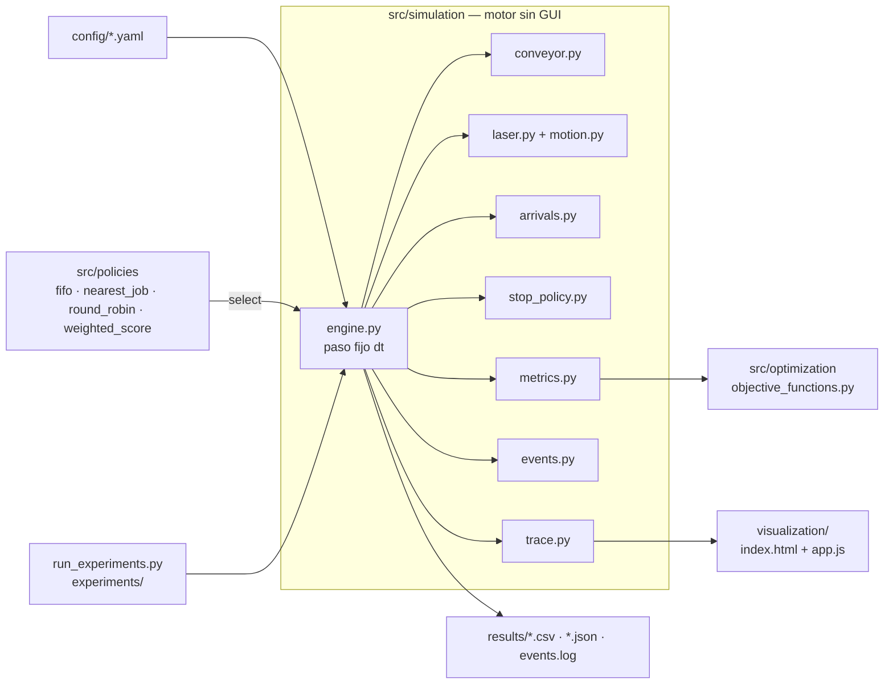

# laser-conveyor-optimization

Prototipo de investigación para **simular** (y, más adelante, **optimizar**) una célula
industrial formada por **un láser cartesiano XY** y **N cintas transportadoras paralelas**.

La V1 es un simulador limpio, modular, reproducible y visual. Aún **no** contiene un
algoritmo de optimización definitivo: deja preparado el terreno (políticas enchufables,
funciones objetivo, formulación del problema) para compararlos después.

---

## 1. Qué problema intentamos resolver

Un único láser (recurso compartido y móvil) debe procesar piezas que llegan de forma
continua por varias cintas. Mientras el láser trabaja una pieza, **solo la cinta de esa
pieza se detiene**; las demás siguen moviéndose. La pregunta de fondo es:

> ¿A qué pieza debe ir el láser a continuación, y cuándo, para minimizar makespan,
> esperas, recorrido del láser y tiempo de parada de las cintas?

Es un problema de *scheduling* de un recurso único con tiempos de preparación (viaje)
dependientes de la secuencia, llegadas dinámicas y bloqueo. Ver
[docs/system_description.md](docs/system_description.md) y
[src/optimization/problem_formulation.md](src/optimization/problem_formulation.md).

## 2. Geometría del sistema

```
                       LÁSER XY  (pórtico: carro X + puente Y, Z fijo)
                                 ↓
               ┌────────┬───────────────────────────────┬────────┐
  C1 (y=0)  →  │ ====== │ ============================= │ ====== │  →
  C2 (y=12) →  │ ====== │ ============================= │ ====== │  →
  C3 (y=24) →  │ ====== │ ============================= │ ====== │  →
               └────────┴───────────────────────────────┴────────┘
               x=0     x=10                            x=45     x=55
               ↑ entrada 10 cm   zona accesible al láser 35 cm   salida 10 cm ↑

  X = dirección de avance de las cintas (+X)     Y = transversal entre cintas     Z = fijo
  Workspace del láser: X ∈ [10, 45] cm, Y ∈ [0, 24] cm (derivado de la geometría)
```

Unidades: **cm, s, cm/s**. Valores por defecto: cintas 5 cm/s, láser 5 cm/s en X y en Y,
procesado 3 s, llegadas cada 8 / 10 / 12 s.

## 3. Instalación

Requiere Python ≥ 3.10.

```powershell
cd laser-conveyor-optimization
python -m venv .venv
.venv\Scripts\Activate.ps1
pip install -r requirements.txt
```

(Linux/macOS: `source .venv/bin/activate`.) Dependencias: `pyyaml` (config), `pytest`
(tests) y `matplotlib` (solo para los gráficos de comparación). No hay SimPy, OR-Tools ni
Pyomo todavía, a propósito.

## 4. Ejecutar una simulación

```powershell
python run_simulation.py
```

Imprime el principio del log de eventos y un resumen de KPIs, y guarda en
`results/<policy>_<mode>_seed<seed>/`:

| fichero | contenido |
|---|---|
| `summary.json`, `summary.csv` | todas las métricas de la ejecución |
| `parts.csv` | una fila por pieza (tiempos de llegada, inicio, fin, salida, espera, flujo, lateness) |
| `events.log`, `events.csv` | log de eventos legible / tabular |
| `queue_lengths.csv` | longitud de cola por cinta cada 0.1 s |
| `trace.json` | traza de estados para la visualización |
| `config_used.json` | configuración exacta usada (reproducibilidad) |

Opciones útiles: `--policy nearest_job`, `--mode stochastic`, `--seed 7`,
`--config config/examples/five_conveyors.yaml`, `--set laser.speed_x=10` (repetible),
`--no-viz`.

## 5. Abrir la visualización

`run_simulation.py` escribe `visualization/data/trace.js`. Después basta con **abrir
`visualization/index.html` con doble clic** (funciona desde `file://`, sin servidor).
Alternativa: `python -m http.server -d visualization 8000` y abrir http://localhost:8000.

Muestra las cintas con sus zonas, las piezas coloreadas por estado (WAITING, MOVING,
READY, PROCESSING, COMPLETED), el pórtico del láser moviéndose en X/Y, qué cinta está
parada (borde naranja, `STOP·LÁSER` o `STOP·BLOQ`), un dashboard, la evolución de las
colas y el log de eventos. Controles: **Play/Pause, Reset, 1x/2x/5x/10x/50x**, barra de
tiempo y botón *Abrir trace.json* para cargar cualquier otra ejecución.

La visualización **solo reproduce** una traza ya calculada: la velocidad visual no puede
cambiar ningún resultado. `python visualization/build_standalone.py` genera un único
HTML autocontenido para compartir una ejecución.

## 6. Cambiar de 3 a N cintas

Todo está en [config/default_config.yaml](config/default_config.yaml). Para 5 cintas:

```yaml
conveyors:
  count: 5
  y_positions: null        # null -> y_i = i * spacing
  spacing: 12.0
arrivals:
  deterministic:
    intervals: [8, 10, 12, 9, 11]   # una por cinta (o un escalar para todas)
    first_arrival: [0, 1, 2, 3, 4]
```

Ejemplo listo: `python run_simulation.py --config config/examples/five_conveyors.yaml`.
El workspace del láser en Y se recalcula solo. Si una lista no tiene N valores, el
programa da un error explicativo.

## 7. Cambiar velocidades

```yaml
conveyors: {speed: 5.0}          # escalar o lista por cinta
laser:
  speed_x: 5.0
  speed_y: 5.0
  motion_model: simultaneous     # o sequential
```

`simultaneous`: `t = max(dx/vx, dy/vy)` (ejes a la vez, por defecto).
`sequential`: `t = dx/vx + dy/vy` (primero X, luego Y). Ver
[docs/mathematical_model.md](docs/mathematical_model.md).

## 8. Cambiar las llegadas

```yaml
arrivals:
  mode: deterministic            # deterministic | stochastic | explicit
  deterministic: {intervals: [8, 10, 12], first_arrival: [0, 1, 2]}
  stochastic:   {distribution: exponential, mean_interarrival: [8, 10, 12]}   # Poisson
  explicit: [{time: 0.0, conveyor: 1, processing_time: 3.0}, ...]           # instancia fija
processing:
  distribution: constant         # constant | uniform | normal
  time: 3.0
```

## 9. Cambiar la política de scheduling

```powershell
python run_simulation.py --policy fifo            # FIFO global (la que más espera)
python run_simulation.py --policy nearest_job     # menor tiempo de viaje del láser
python run_simulation.py --policy round_robin     # C1 → C2 → C3 → C1 ...
python run_simulation.py --policy weighted_score  # w1·espera − w2·viaje + w3·urgencia
```

Pesos de `weighted_score` en `policy.params.weighted_score`. **Añadir una política**:
crea `src/policies/mi_politica.py` con una clase que herede de `BasePolicy`, decórala con
`@register_policy("mi_politica")` e implementa `select(candidates, ctx)`. Se descubre sola;
el motor no se toca.

## 10. Muchas simulaciones (sin interfaz)

```powershell
python run_experiments.py --runs 1000
python run_experiments.py --runs 200 --policies fifo nearest_job --workers 8
python experiments/compare_policies.py --runs 30      # + gráfico comparison.png y Pareto
```

Todas las políticas se evalúan con **las mismas semillas** (números aleatorios comunes).
Salida en `results/experiments/<tag>/`: `runs.csv`, `summary_by_policy.csv/json` (media,
desviación, IC 95 %). Rendimiento orientativo: ≈ 2 s por ejecución de 300 s con
`dt = 0.01` en un portátil; para barridos grandes usa `--workers` y/o
`--set simulation.dt=0.02`.

## 11. Métricas

Tiempo total simulado · piezas generadas / completadas / salidas / salidas sin procesar ·
throughput (piezas/min) · espera media y máxima · flow time medio y máximo · makespan ·
lateness media y máxima · distancia y tiempo de viaje del láser · utilización del láser
(total, procesado, movimiento) · tiempo ocioso del láser · tiempo de parada por cinta
(total, por procesado, por bloqueo) · % en marcha por cinta · cola media y máxima por cinta ·
serie temporal de colas · valor de la función objetivo compuesta. Definiciones en
[src/simulation/metrics.py](src/simulation/metrics.py).

## 12. Qué está preparado para la optimización futura

* `src/policies/`: interfaz `BasePolicy` + registro → cualquier método online (heurística,
  rolling horizon, RL) entra como una política más.
* `src/optimization/objective_functions.py`: objetivos simples y compuesto
  `α·makespan + β·viaje + γ·parada + δ·espera` (pesos en `objective.weights`) y frente de Pareto.
* `arrivals.mode: explicit`: instancias estáticas para métodos offline (MILP, CP-SAT, DP).
* `src/simulation/stop_policy.py`: la regla de parada de cintas es intercambiable.
* Documentación: [problem_formulation.md](src/optimization/problem_formulation.md),
  [decision_variables.md](src/optimization/decision_variables.md),
  [docs/future_optimization.md](docs/future_optimization.md),
  [docs/bicycle_problem_comparison.md](docs/bicycle_problem_comparison.md).

## Arquitectura



```
laser-conveyor-optimization/
├── run_simulation.py            una simulación + resultados + traza visual
├── run_experiments.py           muchas simulaciones (atajo a experiments/run_experiment.py)
├── config/default_config.yaml   ÚNICA fuente de parámetros
├── src/simulation/              motor (no depende de la visualización)
├── src/policies/                políticas de despacho enchufables
├── src/optimization/            objetivos + formulación (para la fase 2)
├── visualization/               reproductor HTML/JS Canvas
├── experiments/                 comparación de políticas
├── tests/                       pytest
└── docs/                        descripción, supuestos, modelo, bicycle problem
```

## Tests

```powershell
python -m pytest
```

## Supuestos principales

Resumen (detalle y justificación en [docs/assumptions.md](docs/assumptions.md)):
motor de paso fijo propio en lugar de SimPy; el láser *intercepta* la pieza en movimiento;
una pieza sin procesar que llega al final de la zona láser **bloquea su cinta** (modo
`block`, configurable a `pass`); piezas en cola aguas arriba si la entrada está ocupada;
sin aceleraciones; el láser solo elige piezas ya dentro de la zona accesible.
