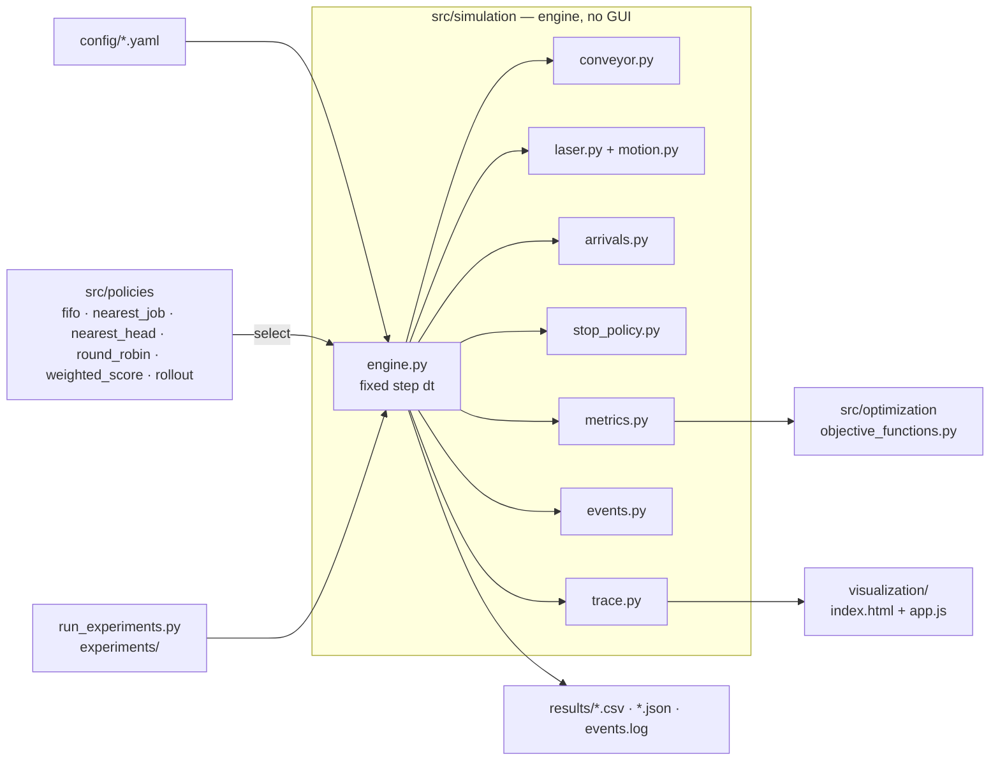

# laser-conveyor-optimization

Research prototype to **simulate** (and later **optimize**) an industrial cell made of
**one XY Cartesian laser** and **N parallel conveyors**.

V1 is a clean, modular, reproducible and visual simulator. It does **not** contain a
final optimization algorithm yet. It provides the groundwork (pluggable policies,
objective functions, problem formulation) to compare optimization methods later.

---

## 1. The problem

A single laser (a shared, mobile resource) must process parts that arrive continuously
on several conveyors. While the laser works on a part, **only that part's conveyor
stops**; the others keep moving. The underlying question is:

> Which part should the laser go to next, and when, to minimize makespan, waiting time,
> laser travel and conveyor downtime?

It is a single-resource scheduling problem with sequence-dependent setup (travel) times,
dynamic arrivals and blocking. See [docs/system_description.md](docs/system_description.md)
and [src/optimization/problem_formulation.md](src/optimization/problem_formulation.md).

## 2. System geometry

```
                       XY LASER  (gantry: X carriage + Y bridge, Z fixed)
                                 ↓
               ┌────────┬───────────────────────────────┬────────┐
  C1 (y=0)  →  │ ====== │ ============================= │ ====== │  →
  C2 (y=12) →  │ ====== │ ============================= │ ====== │  →
  C3 (y=24) →  │ ====== │ ============================= │ ====== │  →
               └────────┴───────────────────────────────┴────────┘
               x=0     x=10                            x=45     x=55
               ↑ entry 10 cm      laser workspace 35 cm       exit 10 cm ↑

  X = conveyor travel direction (+X)     Y = across conveyors     Z = fixed
  Laser workspace: X ∈ [10, 45] cm, Y ∈ [0, 24] cm (derived from the geometry)
```

Units: **cm, s, cm/s**. Current defaults:

| parameter | default |
|---|---|
| conveyor speed | 3 cm/s |
| laser speed X / Y | 10 cm/s / 10 cm/s (simultaneous axes) |
| processing time | 2.5 s per part |
| arrivals (deterministic) | one part every 10 / 12 / 14 s on C1 / C2 / C3 |
| arrival horizon | 300 s, then the system is drained |
| policy | `nearest_job` |
| laser pre-positioning | `none` (only parts already in the laser zone) |
| objective | `penalized_flow_time` = mean flow time + blocking penalty / n |
| blocking penalty | 10 s per blocking event + 1 s per blocked conveyor-second (placeholders) |

With these values the processing load of the laser is
2.5·(1/10 + 1/12 + 1/14) ≈ 0.64, so the cell is busy but stable and the policies give
clearly different results. The earlier, overloaded values are kept in
[config/examples/heavy_load.yaml](config/examples/heavy_load.yaml).

## 3. Installation

Requires Python ≥ 3.10.

```bash
git clone https://github.com/juanlopez-gif/laser-conveyor-optimization.git
cd laser-conveyor-optimization
python -m venv .venv
.venv\Scripts\activate        # Windows  (Linux/macOS: source .venv/bin/activate)
pip install -r requirements.txt
```

Dependencies: `pyyaml` (config), `pytest` (tests), `matplotlib` (plots) and `ortools`
(CP-SAT, used only by the exact solver `src/optimization/solvers/cpsat.py`, which is
skipped with a warning if it is missing). The RL stack is in `requirements-rl.txt`. The
simulator itself is plain Python (no SimPy or Pyomo).

## 4. Run a simulation

```bash
python run_simulation.py
```

It prints the head of the event log and a KPI summary, and writes
`results/<policy>_<mode>_seed<seed>/`:

| file | content |
|---|---|
| `summary.json`, `summary.csv` | every metric of the run |
| `parts.csv` | one row per part (arrival, start, completion, exit, waiting, flow, lateness, processing position and belt-odometer values of the formal model) |
| `events.log`, `events.csv` | readable / tabular event log |
| `queue_lengths.csv` | queue length per conveyor every 0.1 s |
| `trace.json` | state trace for the visualization |
| `config_used.json` | exact configuration used (reproducibility) |

Useful options: `--policy fifo`, `--mode stochastic`, `--seed 7`,
`--config config/examples/five_conveyors.yaml`, `--set laser.speed_x=12` (repeatable),
`--no-viz`, `--only-policy`.

## 5. Open the visualization

`run_simulation.py` runs **every available policy on the same instance** and writes
`visualization/data/trace.js`. Then simply **double-click `visualization/index.html`**
(it works from `file://`, no server needed). Alternative:
`python -m http.server -d visualization 8000` and open http://localhost:8000.

The page shows the conveyors and their zones, parts colored by state (WAITING, MOVING,
READY, PROCESSING, COMPLETED), the laser gantry moving in X/Y, which conveyor is stopped
(orange outline, `STOP·LASER` or `STOP·BLOCK`), a dashboard, queue lengths over time and
the event log. Controls: **policy selector**, **Play/Pause, Reset, 1x/2x/5x/10x/50x**,
a time slider and an *Open trace.json* button to load any other run. Switching policy
keeps the current time, so you can compare policies at the same instant.

The visualization **only replays** a trace that was already computed: the playback speed
cannot change any result. `python visualization/build_standalone.py` bundles the player
and the traces into one self-contained HTML file to share.

## 6. Going from 3 to N conveyors

Everything lives in [config/default_config.yaml](config/default_config.yaml). For 5 conveyors:

```yaml
conveyors:
  count: 5
  y_positions: null        # null -> y_i = i * spacing
  spacing: 12.0
arrivals:
  deterministic:
    intervals: [16, 20, 24, 28, 32]   # one per conveyor (or one scalar for all)
    first_arrival: [0, 1, 2, 3, 4]
```

Ready-made example: `python run_simulation.py --config config/examples/five_conveyors.yaml`.
The laser Y workspace is recomputed automatically. If a list does not have N values the
program stops with an explanatory error.

## 7. Changing speeds

```yaml
conveyors: {speed: 3.0}          # scalar or one value per conveyor
laser:
  speed_x: 10.0
  speed_y: 10.0
  motion_model: simultaneous     # or sequential
```

`simultaneous`: `t = max(dx/vx, dy/vy)` (both axes at once, default).
`sequential`: `t = dx/vx + dy/vy` (X first, then Y). See
[docs/mathematical_model.md](docs/mathematical_model.md).

## 8. Changing arrivals and processing times

```yaml
arrivals:
  mode: deterministic            # deterministic | stochastic | explicit
  deterministic: {intervals: [10, 12, 14], first_arrival: [0, 1, 2]}
  stochastic:   {distribution: exponential, mean_interarrival: [10, 12, 14]}   # Poisson
  explicit: [{time: 0.0, conveyor: 1, processing_time: 2.5}, ...]           # fixed instance
processing:
  distribution: constant         # constant | uniform | normal
  time: 2.5
```

## 9. Choosing the scheduling policy

```bash
python run_simulation.py --policy nearest_job     # shortest laser travel time (default)
python run_simulation.py --policy fifo            # global FIFO (longest waiting part)
python run_simulation.py --policy round_robin     # C1 → C2 → C3 → C1 ...
python run_simulation.py --policy weighted_score  # w1·waiting − w2·travel + w3·urgency
python run_simulation.py --policy nearest_head    # nearest conveyor, but its FIRST unprocessed part
python run_simulation.py --policy rollout         # look-ahead with nearest_job as base policy
```

**Laser pre-positioning** (0.4.0): `--set laser.prepositioning=when_idle` lets an idle
laser go and wait for a part that is still in the entry zone (revoked if another part
becomes READY); `always` makes entry-zone parts permanent candidates (formal model P).
Default `none`. See [docs/CHANGELOG.md](docs/CHANGELOG.md).

or `policy.name` in the config, or the selector in the visualization. Weights of
`weighted_score` are in `policy.params.weighted_score`.

**Adding a policy:** create `src/policies/my_policy.py` with a class that inherits from
`BasePolicy`, decorate it with `@register_policy("my_policy")` and implement
`select(candidates, ctx)`. It is discovered automatically (CLI, experiments and
visualization); the engine does not change.

## 10. Many simulations (headless)

```bash
python run_experiments.py --runs 1000
python run_experiments.py --runs 200 --policies fifo nearest_job --workers 8
python experiments/compare_policies.py --runs 100     # + comparison.png and Pareto front
```

All policies are evaluated on **the same seeds** (common random numbers). Output in
`results/experiments/<tag>/`: `runs.csv`, `summary_by_policy.csv/json` (mean, std,
95 % CI). Indicative speed: ≈ 1–2 s per 300 s run with `dt = 0.01` on a laptop; use
`--workers` and/or `--set simulation.dt=0.02` for large sweeps.

## 11. Metrics

Total simulated time · parts generated / completed / exited / exited unprocessed ·
throughput (parts/min) · average and maximum waiting time · average and maximum flow
time · makespan · average and maximum lateness · laser travel distance and time · laser
utilization (total, processing, movement) · laser idle time · stopped time per conveyor
(total, due to processing, due to blocking) · % running per conveyor · average and
maximum queue per conveyor · queue length time series · **blocking events, blocked
conveyor time and blocking penalty** (0.4.0) · composite objective value.
Definitions in [src/simulation/metrics.py](src/simulation/metrics.py).

## 12. What is ready for future optimization

* `src/policies/`: `BasePolicy` interface + registry → any online method (heuristic,
  rolling horizon, RL) plugs in as one more policy.
* `src/optimization/objective_functions.py`: single objectives (including the blocking
  objectives `blocking_events`, `total_blocked_time`, `blocking_penalty`,
  `penalized_flow_time`, `penalized_makespan`) and the composite weighted sum
  (weights in `objective.weights`), plus a Pareto filter.
* `arrivals.mode: explicit`: static instances for offline methods (MILP, CP-SAT, DP).
* `src/simulation/stop_policy.py`: the conveyor stopping rule is swappable.
* **Formal mathematical model:** [docs/formal_formulation.md](docs/formal_formulation.md) —
  exact continuous-time model, time-indexed MILP, decoder view, online version and
  complexity. `src/optimization/schedule_check.py` verifies that every simulated schedule
  is feasible for that model (`tests/test_formulation.py`).
* Documentation: [problem_formulation.md](src/optimization/problem_formulation.md),
  [decision_variables.md](src/optimization/decision_variables.md),
  [docs/future_optimization.md](docs/future_optimization.md),
  [docs/bicycle_problem_comparison.md](docs/bicycle_problem_comparison.md).

## Optimization methods (phase 2)

Developed by four specialist agents on a shared foundation (see
[docs/agent_architecture.md](docs/agent_architecture.md) for the architecture and the
consolidated results):

| method | where | what it gives |
|---|---|---|
| `cpsat`, `cpsat_ready` | `src/optimization/solvers/cpsat.py` | exact CP-SAT models of the formulation; proven optima for small instances |
| `sa`, `ils` | `src/optimization/solvers/metaheuristics.py` | simulated annealing / iterated local search over processing orders |
| `rollout` policy | `src/policies/rollout.py` | online look-ahead policy; beats nearest_job on 28/30 seeds |
| `nearest_head` policy (0.4.0) | `src/policies/nearest_head.py` | belt-order rule derived from the metaheuristics' best sequences |
| `rl` policy (0.5.0, retrained 0.6.0) | `src/rl/`, `src/policies/rl_policy.py` | SMDP reinforcement learning: behaviour cloning of rollout + DAgger, γ = 1, validation-based selection; see [docs/methods/rl.md](docs/methods/rl.md) |
| `rl2` (0.7.1–0.7.2) | `src/rl2/` | set-of-tokens features and a Transformer pointer dispatcher with a value head (sizes S/M/L), trained by expert iteration on the general problem (N belts, per-belt speeds and rates); see [docs/methods/rl2.md](docs/methods/rl2.md). Training on a larger machine (GPU, resume, Slurm): [docs/methods/remote_training.md](docs/methods/remote_training.md) |
| `fastsim` (0.7.0) | `src/fastsim/` | event-driven simulator, ~20× (vs `dt = 0.05`) to ~80× (vs `dt = 0.01`) faster, for training and search; see [docs/methods/fastsim.md](docs/methods/fastsim.md) |
| hybrids (0.6.0) | `src/policies/hybrid.py` | `rl_rollout`, `rl_filter`, `rl_gated`, `rl_ensemble`; `rl_rollout` is the best policy at default load; see [docs/methods/hybrid.md](docs/methods/hybrid.md) |
| lower bounds | `src/optimization/lower_bounds.py` | proved bounds to measure optimality gaps |

Results of version 0.4.0 (blocking penalty, `nearest_head`, pre-positioning) are in
[docs/methods/nearest_head_prepositioning.md](docs/methods/nearest_head_prepositioning.md);
the RL agent in [docs/methods/rl.md](docs/methods/rl.md); the hybrids and the sensitivity
sweep of 0.6.0 in [docs/methods/hybrid.md](docs/methods/hybrid.md) and
[docs/methods/sensitivity.md](docs/methods/sensitivity.md); the confirmatory evaluation on fresh
seeds (0.6.1), with the policy and pre-positioning effects separated, in
[docs/methods/confirmatory.md](docs/methods/confirmatory.md). Optional RL
dependencies: `pip install -r requirements-rl.txt`.

```bash
PYTHONPATH=src python -m optimization.benchmark --n 6 8 10 --seeds 3 --objective avg_flow_time --time-limit 30
python run_simulation.py --policy rollout
```

## Architecture



```
laser-conveyor-optimization/
├── run_simulation.py            one simulation + results + visualization traces
├── run_experiments.py           many simulations (shortcut to experiments/run_experiment.py)
├── config/default_config.yaml   SINGLE source of parameters (+ config/examples/)
├── src/simulation/              engine (does not depend on the visualization)
├── src/policies/                pluggable dispatching policies
├── src/optimization/            objectives + formulation (for phase 2)
├── visualization/               HTML/JS canvas player
├── experiments/                 policy comparison
├── tests/                       pytest
└── docs/                        description, assumptions, formal formulation, bicycle problem
```

## Tests

```bash
python -m pytest
```

## Main assumptions

Summary (details and rationale in [docs/assumptions.md](docs/assumptions.md)): custom
fixed-step engine instead of SimPy; the laser *intercepts* the moving part; an
unprocessed part reaching the end of the laser zone **stops its conveyor** (`block`
mode, confirmed for the real cell; `pass` kept for what-if studies) and every such
blocking event is penalized in the objective; parts queue upstream when the entry is
occupied; no accelerations; by default the laser only selects parts that are already
inside the laser zone (pre-positioning is optional). All changes are logged with their
rationale in [docs/CHANGELOG.md](docs/CHANGELOG.md).

## Licence

MIT, see [LICENSE](LICENSE). It covers the code, the documentation, the trained models
in `models/` and the configuration files. The reason for the choice is in
[docs/CHANGELOG.md](docs/CHANGELOG.md) (0.6.1).
